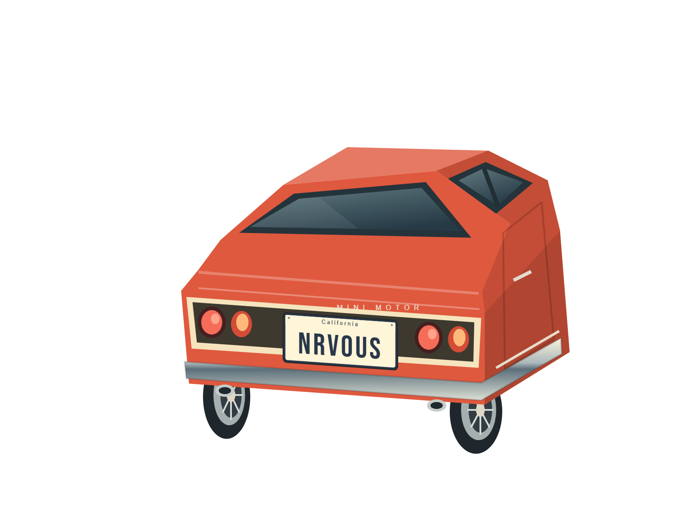
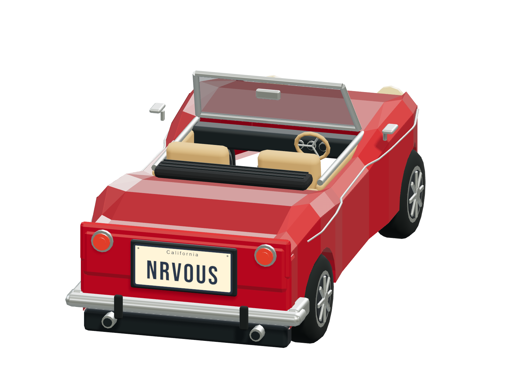
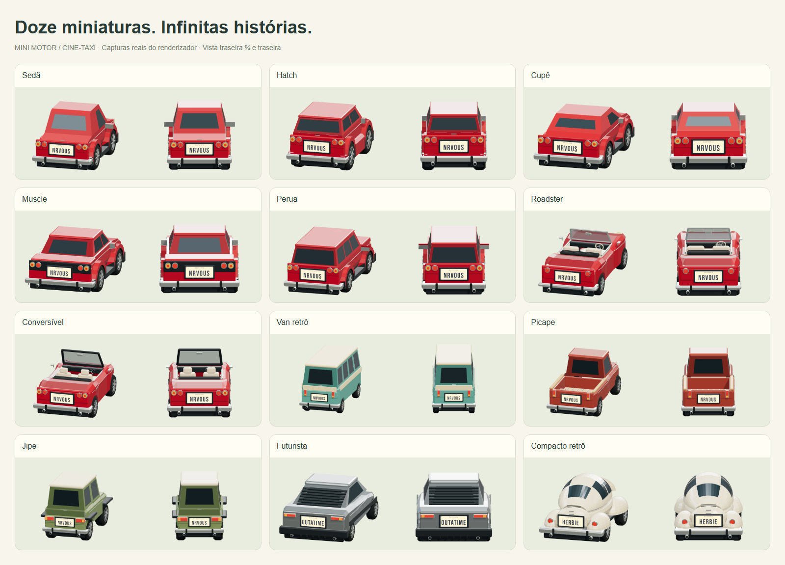
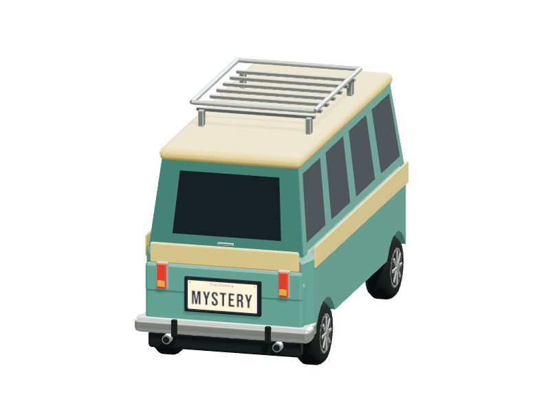
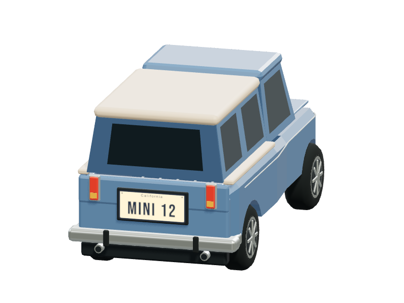
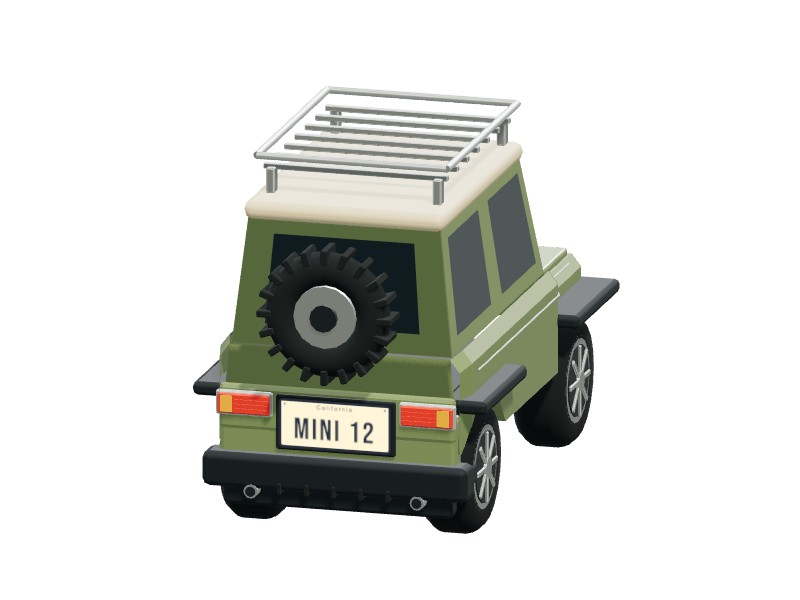
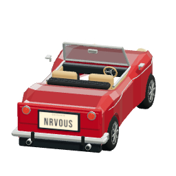

# Mini Motor / Cine-Taxi

Estúdio local para criar miniaturas de carros e placas. A interface original foi preservada; os carros agora são cenas **Three.js / WebGL 2** com geometria tridimensional, câmera ortográfica e peças substituíveis.

Escolha uma carroceria, experimente cores e peças e crie uma placa com a sua assinatura. Depois, leve sua miniatura para fora da garagem.

O estúdio abre com um **roadster clássico vermelho, capota aberta, interior creme e placa NRVOUS**, inspirado no detalhe cinematográfico que deu origem ao projeto. O botão **Recomeçar** restaura essa demonstração; a garagem continua preservando as criações salvas.

| Cupê · NRVOUS | Roadster clássico · NRVOUS |
| :---: | :---: |
|  |  |

*Carros exportados pelo próprio customizador, em PNG com fundo transparente.*

## Executar

Node.js 22.12+ (validado com Node 24):

```sh
npm install
npm run dev
```

Abra o endereço informado pelo Vite. `npm run build` gera `dist/`; `npm run preview` abre a versão de produção. O navegador precisa de WebGL 2. Todos os modelos e fontes são locais: não há backend nem downloads externos durante o uso.

## Renderizador 3D

- Doze modelos: sedã, hatch, cupê, muscle, perua, roadster clássico, conversível moderno, van retrô, picape clássica, jipe, esportivo futurista e compacto retrô.
- Famílias visuais **Clássicos / Esportivos / Utilitários**, com miniaturas 3D e grade de altura limitada.
- Van com teto bicolor e bagageiro; picape com caçamba aberta, lona ou capota; jipe elevado com estepe e bagageiro; esportivo com acabamento em aço; compacto com teto curvo e para-lamas arredondados.
- Roadster e conversível têm carrocerias próprias, habitáculo aberto com bancos, painel, volante e forros de porta. A seleção de capota aberta/fechada e a cor do interior aparecem somente nos modelos compatíveis.
- Chassis adaptados de malhas Kenney; hatch, muscle e perua recebem cabines próprias.
- Rodas tridimensionais, eixos, caixas de roda das malhas, para-choques com volume, lanternas, escapamentos, aerofólios e detalhes montados em coordenadas locais de cada carroceria.
- Pintura brilhante/fosca, vidro, metal e borracha separados; iluminação de estúdio e sombras no chão.
- Botões **Traseira / ¾** no preview. A câmera muda sem alterar a configuração e a exportação usa o ângulo selecionado.
- Miniaturas de seleção e da garagem renderizadas pelos próprios modelos 3D.

O render acontece sob demanda, sem loop de animação contínuo. Há um contexto WebGL para o preview e outro reutilizado por miniaturas/exportações. Malhas, materiais e texturas substituídos são liberados. As cinco malhas base somam aproximadamente 214 KB, antes da compressão HTTP.

### Uma coleção com 12 personalidades



| Van retrô com bagageiro | Picape com capota | Jipe com estepe e bagageiro |
| :---: | :---: | :---: |
|  |  |  |

*Imagens produzidas pelo próprio customizador. A placa, os materiais e os acessórios usam a mesma configuração do preview.*

## Placas e exportação

O editor SVG 2D mantém texto livre, múltiplas linhas, fontes, alinhamentos, tamanho manual ou automático, espaçamento, cores, proporções, bordas e faixas. A mesma composição tipográfica gera um canvas de alta resolução, aplicado ao suporte como `CanvasTexture`. Alterar proporções mantém a proporção interna do texto; o suporte limita o tamanho físico para caber na traseira.

| Botão     | Resultado                                        |
| --------- | ------------------------------------------------ |
| PNG       | Carro 3D com fundo transparente, 1600 × 1160     |
| Placa SVG | Somente a placa, vetorial e com a fonte embutida |
| Ícone     | O mesmo carro 3D, fundo transparente, 256 × 256  |

O chão e sua sombra são exclusivos do estúdio e não aparecem nos PNGs. Em ícones pequenos, placas com textos longos perdem legibilidade naturalmente.

| Sua placa, em SVG | Seu carro, em versão colecionável |
| :---: | :---: |
|  |  |

## Garagem

As configurações continuam no `localStorage`, na chave original `mini-motor-garage`. Configurações da primeira versão mantêm carroceria, cores, peças e placa; campos ausentes recebem os valores iniciais. Limpar os dados do navegador apaga a coleção. A nova renderização muda sua aparência, preservando os valores salvos.

## Organização

| Arquivo                         | Responsabilidade                                                 |
| ------------------------------- | ---------------------------------------------------------------- |
| `src/state.js`                  | Configuração, metadados e compatibilidade da garagem             |
| `src/main.js` / `src/style.css` | Interface original e integração com o preview                    |
| `src/car.js`                    | Montagem do veículo, geometria semântica, faixas e cabine muscle |
| `src/vehicle/models.js`         | Medidas e pontos de montagem de cada modelo                      |
| `src/vehicle/cabins.js`         | Cabines e janelas do hatch e da perua                            |
| `src/vehicle/convertibles.js`   | Carrocerias abertas, interiores e capotas de autoria própria     |
| `src/vehicle/catalog.js`        | Cinco carrocerias novas, caçamba, estepe e bagageiros             |
| `src/vehicle/parts.js`          | Rodas, lanternas, para-choques, placa e acessórios               |
| `src/vehicle/geometry.js`       | Primitivas e liberação de recursos                               |
| `src/materials.js`              | Materiais físicos                                                |
| `src/vehicle/renderer.js`       | Cena, luzes, enquadramento, preview e captura PNG                |
| `src/plate.js`                  | Composição SVG e rasterização da placa                           |
| `src/export.js`                 | Downloads PNG, ícone e SVG da placa                              |
| `public/models/`                | Malhas base adaptadas                                            |
| `scripts/prepare-models.py`     | Conversão reproduzível das malhas de origem                      |

## Origem e licenças

As bases vêm do [Car Kit 3.1, de Kenney](https://kenney.nl/assets/car-kit), distribuído em **CC0**. Materiais, peças e montagem foram adaptados, e três cabines foram reconstruídas. Detalhes por modelo, hash do arquivo de origem e procedimento de conversão estão em [docs/MODELS.md](docs/MODELS.md). A licença original está em `licenses/Kenney-Car-Kit.txt`.

Roadster, conversível e as cinco carrocerias desta expansão são geometria original do projeto. Não acrescentam modelos externos nem downloads durante o uso. Referências, capacidades e construção estão em [docs/CATALOG.md](docs/CATALOG.md).

Three.js usa MIT (`licenses/Three-MIT.txt`). Bebas Neue, Barlow Condensed, Anton e Space Grotesk são distribuídas localmente sob SIL Open Font License 1.1; suas licenças também estão em `licenses/`. Barlow Condensed oferece pesos reais de 400 a 900. Os presets de placa são interpretações visuais e não reproduções normativas oficiais.

## Validação

Com o servidor de desenvolvimento aberto:

```sh
npx playwright install chromium
npm test
```

Os testes verificam editor, restauração de configurações antigas, modelos, dois ângulos, composição da textura, proporção física da placa, peças, PNG com pixels visíveis e alpha transparente, exportações e tela de 390 px. Para repetir apenas as capturas dos cinco modelos em ambos os ângulos:

```sh
node scripts/inspect-3d.mjs
```

As capturas novas estão em `screenshots/3d/`. Veja [docs/VISUAL-QA.md](docs/VISUAL-QA.md) para a inspeção visual, correções e limitações. As capturas da primeira implementação permanecem em `screenshots/` para comparação histórica.

Para capturar os dois conversíveis, nas duas posições de capota e nos dois ângulos:

```sh
node scripts/inspect-convertibles.mjs
```

O script usa `http://127.0.0.1:5173` por padrão; `STUDIO_URL` permite outro endereço. Os resultados ficam em `screenshots/convertibles/`. A decisão de escopo, os modelos pendentes e a geometria dos interiores estão em [docs/CONVERTIBLES.md](docs/CONVERTIBLES.md).

Para gerar a galeria atual dos **12 carros**, nos dois ângulos, e os exemplos de acessórios:

```sh
node scripts/inspect-catalog.mjs
node scripts/inspect-catalog-options.mjs
node scripts/gallery-catalog.mjs
```

As capturas ficam em `screenshots/catalog/`. Os testes incluem caçamba aberta, capacidades incompatíveis, restauração da garagem, demonstração inicial e obstrução da placa com acessórios instalados. A documentação histórica dos sete modelos anteriores foi preservada.
